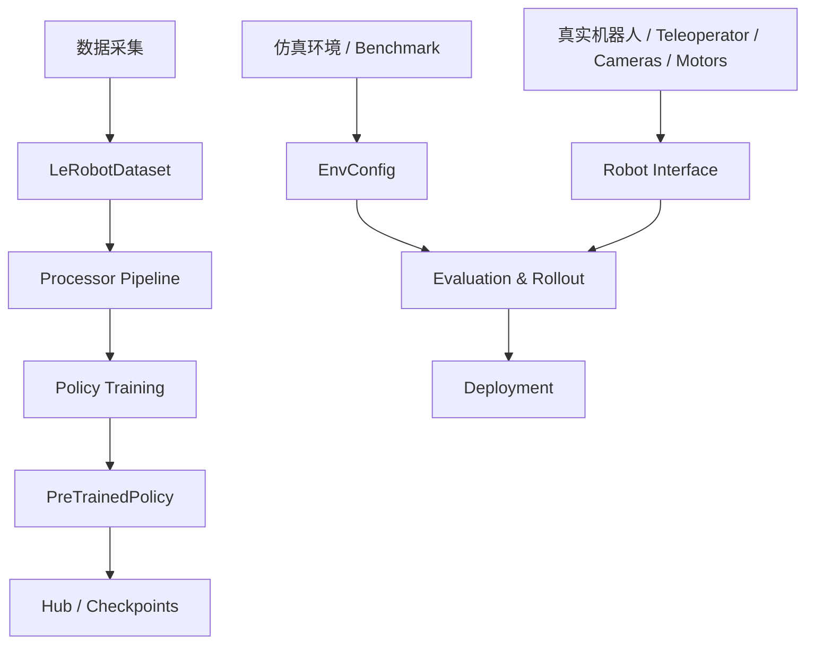

# LeRobot 架构设计文档（开发者版）

## 1. 项目定位

LeRobot 是一个面向现实世界机器人学习的 PyTorch 框架，目标是把机器人学习中的关键能力统一到一个工程化、可扩展、可复现的系统中：

- 数据采集与数据集管理
- 训练与评估策略
- 真实机器人控制与遥操作
- 仿真环境与 benchmark
- 模型共享与 Hub 部署

从架构角度看，LeRobot 不是单一的“算法库”，而是一个机器人学习基础设施（robot learning infrastructure）。它将数据、模型、环境、硬件接口统一抽象，降低从数据收集到训练部署的工程成本。

---

## 2. 总体架构视图

从工程视角，LeRobot 的核心分层可概括为：

1. 硬件层：Robot / Teleoperator / Cameras / Motors
2. 数据层：Dataset / Processor
3. 模型层：Policy / Reward / RL algorithms
4. 环境层：EnvConfig / Gymnasium benchmark
5. 训练层：TrainPipelineConfig / Accelerate / Optimizer
6. 评估与部署层：Rollout / Eval / Hub

---

## 3. 代码组织结构

核心源码位于 `src/lerobot/` 下，目录职责如下：

### 3.1 配置层
- `configs/`
- 定义训练、评估、策略和环境配置
- 训练入口的核心是 `TrainPipelineConfig`
- 采用 dataclass + draccus 的配置系统，支持 CLI 参数和 Hub 加载

关键文件：
- `src/lerobot/configs/train.py`
- `src/lerobot/configs/policies.py`
- `src/lerobot/configs/default.py`

### 3.2 数据层
- `datasets/`
- 包含 `LeRobotDataset` 与 dataset metadata
- 负责 episode-aware sampling、视频解码、Parquet 和图像/视频混合存储

关键文件：
- `src/lerobot/datasets/lerobot_dataset.py`
- `src/lerobot/datasets/factory.py`

### 3.3 模型层
- `policies/`
- 统一基类为 `PreTrainedPolicy`
- 具体策略按任务类别拆分：ACT、Diffusion、SmolVLA、Pi0、Pi0.5、XVLA 等

关键文件：
- `src/lerobot/policies/pretrained.py`
- `src/lerobot/policies/factory.py`

### 3.4 环境层
- `envs/`
- 定义仿真环境配置与 benchmark
- 支持 Gymnasium 接口与 vector env

关键文件：
- `src/lerobot/envs/configs.py`

### 3.5 真实硬件层
- `robots/`
- `teleoperators/`
- `cameras/`
- `motors/`
- 负责真实世界控制与遥操作

### 3.6 训练与优化层
- `optim/`
- `rl/`
- `rewards/`
- 负责 loss、优化器、调度器、奖励模型与 RL 算法

### 3.7 处理器层
- `processor/`
- 对输入输出进行标准化转换
- 负责使数据格式适配不同策略和环境

### 3.8 运行时与脚本层
- `scripts/`
- CLI 命令入口，如 `lerobot-train`, `lerobot-eval`, `lerobot-record`, `lerobot-teleoperate`

---

## 4. 核心抽象与设计原则

### 4.1 `TrainPipelineConfig`
训练系统的总入口，定义全局训练参数。

它聚合了：
- 数据集配置 `dataset`
- 环境配置 `env`
- 策略配置 `policy`
- 优化器 `optimizer`
- scheduler `scheduler`
- 输出目录 `output_dir`
- 评估参数 `eval`
- WandB 配置 `wandb`
- 断点恢复 `resume`

它的设计特点是：
- 统一、全局、可复现实
- 支持 CLI 覆盖参数
- 可保存为 JSON 配置
- 支持从 checkpoint 恢复

---

### 4.2 `PreTrainedPolicy`
`PreTrainedPolicy` 是策略模块的统一父类，定义了：

- 初始化与加载逻辑
- 训练/推理接口
- 保存与加载检查点
- Hub 集成逻辑
- 处理输入/输出的规范化能力

所有具体策略都遵循同一接口，因此：
- 训练脚本无需知道具体模型类型
- 评估和推理逻辑统一
- 模型在 hub 中可被复用

---

### 4.3 `EnvConfig`
`EnvConfig` 是仿真环境配置的抽象基类。它的职责包括：

- 统一 benchmark 的注册方式
- 生成 `gym_id`
- 解析 environment-specific kwargs
- 创建 vectorized env
- 在训练中提供评估环境入口

每个具体 benchmark（如 Libero、MetaWorld、Aloha 等）都是一个 `EnvConfig` 子类。

---

### 4.4 `RobotConfig` 与 `TeleoperatorConfig`
真实操作层的抽象：

- `RobotConfig`: 机器人实例配置
- `TeleoperatorConfig`: 遥操作设备配置

由此实现：
- 不同硬件平台共用同一套控制接口
- 采集数据和部署策略不依赖单一硬件型号
- 支持多种机器人平台，如 SO-100、SO-101、Koch、Reachy 等

---

## 5. 数据流：从采集到训练

LeRobot 最关键的工程链路是：

1. 用户使用上位机 / teleop 采集动作示范
2. 采集器写入 `LeRobotDataset`
3. 数据经过 Processor Pipeline 清洗与转换
4. 训练器读取 dataset batch
5. 策略进行 forward / backward
6. checkpoint 与日志保存在输出目录
7. 评估器在仿真或真实环境中检查效果

这一链路使得数据、模型和部署之间存在明确接口边界，便于扩展和维护。

---

## 6. 训练循环设计

训练主入口在 `src/lerobot/scripts/lerobot_train.py`，主逻辑如下：

1. 调用 `cfg.validate()` 验证配置
2. 构建 `Accelerator`
3. 初始化日志与随机种子
4. 创建 dataset 与 eval dataset
5. 构建 policy / optimizer / scheduler
6. 进入主训练循环
7. 执行 `policy.forward(batch)`
8. `accelerator.backward(loss)`
9. 梯度裁剪与 optimizer.step()
10. 周期性保存 checkpoint
11. 在需要时执行仿真评估
12. 推送模型到 Hub（可选）

关键训练函数：
- `train(cfg, accelerator=None)`
- `update_policy(...)`

此处的工程设计重点是：
- 训练逻辑与具体策略解耦
- 多卡/混合精度由 Accelerate 承担
- 配置驱动训练过程
- 可中断恢复与定期评估

---

## 7. Diffusion Policy 的架构特征

以 `DiffusionPolicy` 为例，可以理解 LeRobot 中策略实现的典型结构：

- `DiffusionPolicy` 继承自 `PreTrainedPolicy`
- 通过 `select_action()` 维护 observation/action queue
- 通过 `predict_action_chunk()` 批量生成动作
- 通过 `forward()` 计算训练 loss
- 底层 `DiffusionModel` 负责去噪过程

在代码中，核心调用链为：

- `select_action()` -> `predict_action_chunk()`
- `predict_action_chunk()` -> `self.diffusion.generate_actions()`
- `generate_actions()` -> U-Net conditional sampling

其中 `generate_actions` 的作用是：
- 根据当前 observation 和历史上下文
- 提供全局条件 `global_cond`
- 通过 diffusion denoising 生成未来动作序列

该设计体现了自然的 robotics policy 模式：

- 视觉观测和状态观测共同编码
- 形成动作序列条件
- 通过去噪模型生成控制信号

这也是 LeRobot 中很多较大策略设计的共同特征：从观测到动作的条件生成。

---

## 8. 策略扩展与插件机制

LeRobot 通过 `ChoiceRegistry` 和多态配置实现策略/环境/优化器的注册机制：

- `@EnvConfig.register_subclass("name")`
- `@PolicyConfig.register_subclass("name")`
- `ChoiceRegistry` 统一实例化与工厂生产

工程上，这意味着：
- 新增算法不需要改动训练入口
- 新增 benchmark 不需要修改主控制流程
- 通过类型注册即可接入框架

这正是该项目工程成熟度的重要特征之一。

---

## 9. 评估与仿真整合

LeRobot 的评估不是纯训练日志，而是和环境/benchmark 紧密耦合：

- 单步推理
- rollout 评估
- 真实机器人部署
- benchmark 成功率统计

环境评估可以在：
- 仿真环境中完成
- 真实硬件上完成
- 通过统一接口切换目标

这意味着研究者可以在同一路径下比较：
- offline dataset performance
- online simulator performance
- real-world deployment performance

---

## 10. 工程优点

### 10.1 统一抽象
数据、模型、环境、机器人统一接口，减少代码分叉。

### 10.2 可扩展性
新增策略、环境、机器人都可以按模块扩展，不需要重写框架核心。

### 10.3 可复现性
配置化训练和 checkpoint 恢复使实验比较容易进行。

### 10.4 生态友好
与 Hugging Face Hub 集成，利于共享数据和模型。

### 10.5 真实部署兼容
不仅能在仿真环境中运行，还能落到真实机器人上。

---

## 11. 代码开发建议

如果你要在该框架中做二次开发，建议优先关注以下位置：

1. 配置入口：`src/lerobot/configs/train.py`
2. 策略抽象：`src/lerobot/policies/pretrained.py`
3. 训练入口：`src/lerobot/scripts/lerobot_train.py`
4. 数据接口：`src/lerobot/datasets/lerobot_dataset.py`
5. 环境注册：`src/lerobot/envs/configs.py`
6. 实际策略实现：如 `src/lerobot/policies/diffusion/modeling_diffusion.py`

从工程角度，理解接口设计比理解某个单模型实现更重要，因为 LeRobot 的核心价值就在于接口统一。

---

## 12. 总结

LeRobot 的架构非常典型：

- 顶层是实验驱动的机器人学习平台
- 中层是统一的数据/模型/环境抽象
- 底层是稳定的真实硬件与仿真接口

其本质是：让机器人学习从“单模型实验”转变为“工程化、自洽、可扩展的跨平台学习系统”。

这也是它作为现代机器人学习框架的重要价值所在。
